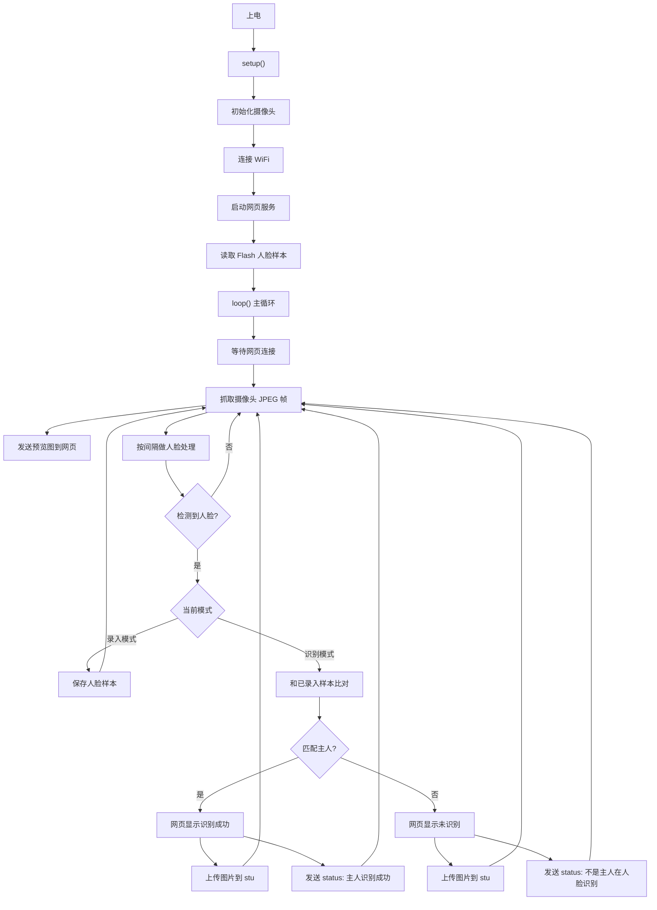

# ESP32-CAM 人脸识别上传版代码讲解

这份文档对应当前工程：

```text
ESP32CAM_JPEG_CN
```

现在这版已经去掉外接硬件逻辑，不再控制红灯、绿灯、蜂鸣器、继电器，也没有开门动作。

当前目标只有四件事：

```text
1. 摄像头预览
2. 人脸录入和保存
3. 自动人脸识别
4. 把图片和识别结果上传到巴法云
```

---

## 1. 工程文件说明

工程里主要有这些文件：

```text
ESP32CAM_JPEG_CN.ino   主程序，所有核心逻辑都在这里
HTML_interface.html    网页源码，按钮和页面布局在这里
camera_index.h         网页压缩后的 C 数组，ESP32 实际发送的是它
camera_pins.h          AI Thinker ESP32-CAM 摄像头引脚
partitions.csv         分区表，包含保存人脸用的 fr 分区
CODE_WALKTHROUGH_CN.md 当前这份讲解文档
```

关系是：

```text
ESP32CAM_JPEG_CN.ino 控制设备逻辑
HTML_interface.html 控制网页长什么样
camera_index.h 是 HTML_interface.html 压缩后给 ESP32 用的版本
camera_pins.h 告诉程序摄像头接在哪些 GPIO
partitions.csv 给 Flash 划出 fr 区域保存人脸样本
```

注意：

```text
改了 HTML_interface.html 以后，需要重新生成 camera_index.h。
否则网页不会变化。
```

---

## 2. 整体功能流程

设备开机后，大流程是：

```text
ESP32-CAM 上电
-> 初始化摄像头
-> 连接 WiFi
-> 启动网页服务
-> 初始化人脸识别
-> 从 Flash 读取已录入的人脸样本
-> 网页显示摄像头画面
-> 程序每隔几秒检测/识别人脸
-> 是主人：上传图片到 stu，发送“主人识别成功”到 status
-> 不是主人：上传图片到 stu，发送“不是主人在人脸识别”到 status
```

简单一句话：

```text
抓图 -> 检测人脸 -> 识别人脸 -> 上传图片 -> 发送状态
```

---

## 3. 流程图



---

## 4. include 是什么

代码开头有：

```cpp
#include <Arduino.h>
#include <WiFi.h>
#include <HTTPClient.h>
#include <ArduinoWebsockets.h>
#include "esp_camera.h"
#include "esp_http_server.h"
#include "esp_partition.h"
#include "img_converters.h"
#include "camera_index.h"
```

这些是“引入工具”。

每个工具负责的事情：

```text
Arduino.h              Arduino 基础功能
WiFi.h                 连接 WiFi
HTTPClient.h           通过 HTTP 上传图片和状态到巴法云
ArduinoWebsockets.h    网页和 ESP32 实时通信
esp_camera.h           摄像头驱动
esp_http_server.h      ESP32 网页服务器
esp_partition.h        查找 Flash 分区
img_converters.h       图片格式转换
camera_index.h         压缩后的网页
```

人脸识别相关是：

```cpp
#include "human_face_detect_msr01.hpp"
#include "human_face_detect_mnp01.hpp"
#include "face_recognition_112_v1_s8.hpp"
```

它们分别负责：

```text
human_face_detect_msr01.hpp      第一阶段人脸检测
human_face_detect_mnp01.hpp      第二阶段人脸检测和关键点
face_recognition_112_v1_s8.hpp   人脸识别模型
```

人脸识别不是一步完成的。

它的流程是：

```text
先找画面里有没有脸
再确认脸的位置和关键点
最后把这张脸和已保存的人脸样本比对
```

---

## 5. WiFi 和巴法云配置

代码里有：

```cpp
const char *ssid = "YOUR_WIFI_SSID";
const char *password = "YOUR_WIFI_PASSWORD";
const char *BEMFA_UID = "YOUR_BEMFA_PRIVATE_KEY";
const char *BEMFA_TOPIC = "stu";
const char *BEMFA_STATUS_TOPIC = "status";
const char *BEMFA_UPLOAD_URL = "http://apis.bemfa.com/vb/api/v1/imagesUploadBin";
const char *BEMFA_STATUS_URL = "http://apis.bemfa.com/va/postJsonMsg";
```

含义：

```text
ssid                  WiFi 名字
password              WiFi 密码
BEMFA_UID             巴法云私钥
BEMFA_TOPIC           图片主题，当前是 stu
BEMFA_STATUS_TOPIC    状态主题，当前是 status
BEMFA_UPLOAD_URL      巴法云图片上传接口
BEMFA_STATUS_URL      巴法云文字消息接口
```

图片和状态是分开发的：

```text
stu     收图片
status  收文字
```

例如：

```text
图片上传到 stu
“主人识别成功”发送到 status
“不是主人在人脸识别”发送到 status
```

注意：

```text
BEMFA_UID 是私钥，不要公开发给别人。
```

---

## 6. 人脸保存数量

代码里有：

```cpp
#define ENROLL_CONFIRM_TIMES 5
#define PERSON_SAVE_NUMBER 7
#define FACE_ID_SAVE_NUMBER (PERSON_SAVE_NUMBER * ENROLL_CONFIRM_TIMES)
#define ENROLL_NAME_LEN 32
```

意思是：

```text
ENROLL_CONFIRM_TIMES = 5
每个人录入 5 次样本。

PERSON_SAVE_NUMBER = 7
最多保存 7 个人。

FACE_ID_SAVE_NUMBER = 7 * 5
最多保存 35 个样本。

ENROLL_NAME_LEN = 32
名字最长大约 32 个字符。
```

为什么一个人要录 5 次？

因为人脸会因为距离、角度、光线变化而变化。

录入建议：

```text
第 1 次：正脸
第 2 次：稍近
第 3 次：稍远
第 4 次：轻微左偏
第 5 次：轻微右偏
```

这样比 5 次都用同一个距离更稳。

---

## 7. 摄像头型号

代码里有：

```cpp
#define CAMERA_MODEL_AI_THINKER
#include "camera_pins.h"
```

表示当前板子是 AI Thinker ESP32-CAM。

`camera_pins.h` 里保存摄像头引脚映射。

如果以后换板子，可能要改这里。

---

## 8. 人脸识别核心对象

代码里有：

```cpp
static HumanFaceDetectMSR01 detector_stage1(0.1F, 0.5F, 10, 0.2F);
static HumanFaceDetectMNP01 detector_stage2(0.5F, 0.3F, 5);
static FaceRecognition112V1S8 recognizer;
```

可以这样理解：

```text
detector_stage1   粗略找脸
detector_stage2   精确找脸和关键点
recognizer        录入、保存、读取、识别人脸
```

如果画面里没有脸，后面的识别不会执行。

如果检测到脸，才会进入录入或识别。

---

## 9. 状态机 g_state

代码里定义了几种模式：

```cpp
typedef enum
{
  START_STREAM,
  START_DETECT,
  START_RECOGNITION,
  START_ENROLL,
  DELETE_ALL,
} en_fsm_state;
```

每个模式含义：

```text
START_STREAM        只看视频预览
START_DETECT        检测有没有人脸
START_RECOGNITION   识别人脸
START_ENROLL        录入人脸
DELETE_ALL          删除全部人脸
```

现在默认是：

```cpp
en_fsm_state g_state = START_RECOGNITION;
```

意思是：

```text
上电后默认自动识别人脸。
```

---

## 10. 时间参数

代码里有：

```cpp
const unsigned long DETECT_INTERVAL_MS = 1500;
const unsigned long ENROLL_INTERVAL_MS = 1200;
const unsigned long RECOGNIZE_INTERVAL_MS = 3000;
const unsigned long PREVIEW_INTERVAL_MS = 100;
const unsigned long CLOUD_REPORT_COOLDOWN_MS = 30000;
```

含义：

```text
DETECT_INTERVAL_MS = 1500
检测模式下，每 1.5 秒检测一次。

ENROLL_INTERVAL_MS = 1200
录入模式下，每 1.2 秒采一次样本。

RECOGNIZE_INTERVAL_MS = 3000
识别模式下，每 3 秒识别一次。

PREVIEW_INTERVAL_MS = 100
网页预览最多约 10fps。

CLOUD_REPORT_COOLDOWN_MS = 30000
巴法云 30 秒内最多上报一次。
```

为什么不每一帧都识别？

因为经典 ESP32-CAM 算力很弱。人脸检测和识别很耗时间，如果每帧都跑，画面会卡死。

所以代码策略是：

```text
网页预览持续发
人脸识别隔几秒跑一次
云端上报 30 秒内最多一次
```

---

## 11. setup() 开机流程

`setup()` 是开机只执行一次的函数。

它做这些事：

```text
1. 打开串口
2. 配置摄像头参数
3. 初始化摄像头
4. 连接 WiFi
5. 启动网页服务
6. 初始化人脸识别
7. 启动 WebSocket 服务
8. 打印网页访问地址
```

### 11.1 打开串口

```cpp
Serial.begin(115200);
```

串口监视器要选：

```text
115200
```

### 11.2 配置摄像头

代码里有：

```cpp
camera_config_t config;
```

这是摄像头配置。

关键配置：

```cpp
config.pixel_format = PIXFORMAT_JPEG;
```

表示摄像头输出 JPEG。

这对网页预览比较快，因为浏览器能直接显示 JPEG。

还有：

```cpp
config.frame_size = FRAMESIZE_UXGA;
```

初始化时先用较大尺寸申请缓冲。

后面实际运行会设置成：

```cpp
s->set_framesize(s, FRAMESIZE_QVGA);
```

QVGA 是 320x240。

这样比较适合经典 ESP32-CAM。

### 11.3 初始化摄像头

```cpp
esp_camera_init(&config);
```

这句是真正启动摄像头。

如果失败，会打印：

```text
摄像头初始化失败
```

### 11.4 连接 WiFi

```cpp
WiFi.begin(ssid, password);
```

连接成功后会打印：

```text
WiFi 已连接
```

### 11.5 启动网页

```cpp
app_httpserver_init();
```

这个函数启动 ESP32 的网页服务器。

浏览器打开串口里显示的 IP，就能看到网页。

### 11.6 初始化人脸识别

```cpp
app_facenet_main();
```

它会：

```text
设置识别阈值
查找 fr 分区
从 Flash 读取人脸样本
```

正常会看到：

```text
Flash 模式：已载入 9 个人脸样本
```

如果看到：

```text
未找到人脸分区 fr
```

说明分区表没刷好，人脸不能可靠保存。

---

## 12. loop() 主循环

`loop()` 会一直执行。

它做的事：

```text
1. 等待网页连接
2. 网页连接后发送已录入人脸列表
3. 不断从摄像头抓一帧 JPEG
4. 处理网页按钮消息
5. 按间隔做人脸检测/识别
6. 按间隔发送预览画面
7. 释放摄像头帧
8. 重复
```

抓图：

```cpp
fb = esp_camera_fb_get();
```

`fb` 可以理解成当前这张照片。

发送预览：

```cpp
send_preview_frame(fb, client);
```

处理人脸：

```cpp
process_face_frame(fb, client);
```

释放照片：

```cpp
esp_camera_fb_return(fb);
```

释放非常重要。

如果不释放，摄像头缓冲会被占满，程序会卡住。

---

## 13. 网页按钮怎么控制程序

网页和 ESP32 通过 WebSocket 通信。

处理按钮消息的函数是：

```cpp
handle_message(WebsocketsClient &client, WebsocketsMessage msg)
```

它先读取网页发来的文字：

```cpp
String data = msg.data();
```

然后判断是哪种命令。

### 13.1 视频预览

```cpp
if (data == "stream")
```

进入只看预览模式。

### 13.2 检测人脸

```cpp
else if (data == "detect")
```

当前代码里，点击检测人脸会进入识别模式，并强制下一次检测到脸时上报云端。

### 13.3 录入人脸

```cpp
else if (data.startsWith("capture:"))
```

网页会发：

```text
capture:名字
```

ESP32 会把名字保存到：

```cpp
st_name.enroll_name
```

然后进入录入模式：

```cpp
g_state = START_ENROLL;
```

### 13.4 人脸识别

```cpp
else if (data == "recognise")
```

进入识别模式，并强制下一次检测到脸时上报云端。

### 13.5 删除人脸

```cpp
else if (data.startsWith("remove:"))
```

删除某个名字的人脸。

### 13.6 删除全部

```cpp
else if (data == "delete_all")
```

清空人脸库。

---

## 14. process_face_frame() 核心流程

这是最重要的函数。

它负责：

```text
把图片转成模型能处理的格式
检测有没有人脸
录入人脸
识别人脸
上传图片
发送识别结果
```

流程：

```text
摄像头 JPEG
-> 转 RGB888
-> 人脸检测
-> 如果没脸，返回
-> 如果录入模式，保存样本
-> 如果识别模式，和人脸库比对
-> 主人：网页显示成功，上传图片，发送 status 成功消息
-> 非主人：网页显示未识别，上传图片，发送 status 警报消息
```

### 14.1 JPEG 转 RGB888

```cpp
prepare_rgb_frame(frame, tensor)
```

摄像头输出 JPEG，但人脸模型不能直接吃 JPEG。

所以要转换成 RGB888。

`tensor` 是模型需要的数据格式。

你可以简单理解：

```text
tensor = 模型能看懂的图片
```

### 14.2 检测人脸

```cpp
detect_faces(frame, &results)
```

如果没检测到脸，后面不会识别。

为了避免状态一闪一闪，代码用了：

```cpp
missed_face_count
```

连续漏检几次后才提示“未检测到人脸”。

### 14.3 录入人脸

录入时执行：

```cpp
recognizer.enroll_id(...)
```

每录一次：

```cpp
enroll_samples_left--;
```

录够 5 次后：

```text
xxx 录入完成
```

并返回自动识别模式。

### 14.4 识别人脸

识别时执行：

```cpp
face_info_t face = recognizer.recognize(tensor, landmarks);
```

如果：

```cpp
face.id >= 0
```

说明匹配到已录入的人。

如果小于 0，说明没有匹配到主人。

---

## 15. 识别成功后做什么

识别成功时，代码会：

```cpp
report_cloud_event(frame, client, "主人识别成功");
send_recognized(client, face);
```

意思是：

```text
1. 上传当前图片到巴法云 stu
2. 发送“主人识别成功”到巴法云 status
3. 网页显示“识别成功：名字”
4. 串口打印识别成功
```

注意：

```text
现在没有开门、没有继电器、没有蜂鸣器、没有红绿灯。
```

---

## 16. 识别失败后做什么

识别失败时，代码会：

```cpp
report_cloud_event(frame, client, "不是主人在人脸识别");
send_not_recognized(client);
```

意思是：

```text
1. 上传当前图片到巴法云 stu
2. 发送“不是主人在人脸识别”到巴法云 status
3. 网页显示“未识别到已录入人脸”
4. 串口打印未识别
```

---

## 17. 巴法云图片上传

图片上传函数是：

```cpp
upload_face_image_to_bemfa(frame, client)
```

它使用接口：

```text
http://apis.bemfa.com/vb/api/v1/imagesUploadBin
```

请求头里带：

```text
Authorization: BEMFA_UID
Authtopic: stu
Content-Type: image/jpg
```

意思是：

```text
用你的私钥，把当前 JPEG 图片上传到 stu 图片主题。
```

成功时串口会显示：

```text
Bemfa upload OK, HTTP 200
```

失败时可能显示：

```text
Bemfa upload failed, HTTP -11
```

`-11` 多数是图片接口响应超时。

现在设计原则是：

```text
图片上传失败，不影响本地识别。
```

---

## 18. 巴法云状态上报

状态上报函数是：

```cpp
publish_status_to_bemfa(message)
```

它使用接口：

```text
http://apis.bemfa.com/va/postJsonMsg
```

发送内容类似：

```json
{
  "uid": "你的私钥",
  "topic": "status",
  "type": 1,
  "msg": "主人识别成功"
}
```

其中：

```text
topic = status
type = 1 表示 MQTT 主题
msg = 要发送的消息
```

如果你的 `status` 是 TCP 主题，`type` 要改成 `3`。

你现在参考的是 MQTT 文档，所以保留 `1`。

---

## 19. 云端上报限流

代码里有：

```cpp
CLOUD_REPORT_COOLDOWN_MS = 30000
```

意思是：

```text
30 秒内最多上传一次图片和状态。
```

为什么要限流？

因为人一直站在镜头前时，程序会不断识别。

如果每次都上传：

```text
ESP32 会卡
巴法云会被刷屏
图片接口更容易超时
```

所以代码通过：

```cpp
should_report_cloud_event()
```

判断现在能不能上报。

---

## 20. send_preview_frame() 网页预览

这个函数负责把摄像头画面发给网页。

因为当前摄像头输出 JPEG：

```cpp
if (frame->format == PIXFORMAT_JPEG)
{
  client.sendBinary((const char *)frame->buf, frame->len);
  return true;
}
```

也就是：

```text
如果摄像头已经给了 JPEG，就直接发给浏览器。
```

这样比 RGB565 版本快很多。

---

## 21. app_facenet_main() 人脸库初始化

这个函数做三件事：

```cpp
recognizer.set_thresh(0.55F);
recognizer.set_partition(..., "fr");
recognizer.set_ids_from_flash();
```

解释：

```text
set_thresh(0.55F)
设置识别严格程度。

set_partition(..., "fr")
告诉识别器，人脸数据保存在哪个 Flash 分区。

set_ids_from_flash()
从 Flash 读取已经录入的人脸。
```

如果启动时看到：

```text
Flash 模式：已载入 9 个人脸样本
```

说明人脸样本保存和读取成功。

---

## 22. partitions.csv 为什么必须有

`partitions.csv` 里有：

```text
fr, data, , 0x310000, 0xF0000,
```

这个 `fr` 分区就是保存人脸样本的地方。

没有它会出现：

```text
Partition Not found
Please Set the Partition
```

后果：

```text
录入的人脸重启后可能丢失。
```

---

## 23. 没有外接硬件后，代码删除了什么

当前版本已经删除：

```text
红灯 green/red 控制
蜂鸣器 buzzer 控制
继电器 relay 控制
open_door() 开门函数
door_open 网页消息
开门 5 秒后自动关闭的逻辑
```

现在识别成功只做：

```text
网页显示
串口打印
图片上传
状态上报
```

识别失败只做：

```text
网页显示
串口打印
图片上传
状态上报
```

---

## 24. 常见日志

### 正常启动

```text
WiFi 已连接
网页服务已启动
Flash 模式：已载入 9 个人脸样本
摄像头已就绪，请打开 http://192.168.xxx.xxx/
```

### 图片上传成功

```text
Bemfa upload OK, HTTP 200
```

### 状态上报成功

```text
Bemfa status OK, HTTP 200, msg: 主人识别成功
```

### 图片上传超时

```text
Bemfa upload failed, HTTP -11
```

通常是巴法云图片接口响应慢。

### 没有人脸分区

```text
Partition Not found
```

说明 `fr` 分区没刷进去。

---

## 25. 你最应该认识的函数

先认识这几个就够：

```cpp
setup()
```

开机初始化。

```cpp
loop()
```

一直循环抓图、预览、识别。

```cpp
handle_message()
```

处理网页按钮。

```cpp
process_face_frame()
```

检测、录入、识别人脸，是核心。

```cpp
upload_face_image_to_bemfa()
```

上传图片到 `stu`。

```cpp
publish_status_to_bemfa()
```

发送文字到 `status`。

```cpp
report_cloud_event()
```

把图片上传和状态发送组合起来。

---

## 26. 可以安全改的参数

识别间隔：

```cpp
RECOGNIZE_INTERVAL_MS = 3000;
```

越大越不卡，但反应慢。

云端上报间隔：

```cpp
CLOUD_REPORT_COOLDOWN_MS = 30000;
```

越大越不刷屏。

识别阈值：

```cpp
recognizer.set_thresh(0.55F);
```

理解：

```text
数值大：更严格，不容易误认，但可能认不出主人
数值小：更宽松，更容易认出主人，但误认风险更高
```

建议小幅调整，比如：

```text
0.55 -> 0.52
```

不要一下改太多。

录入次数：

```cpp
ENROLL_CONFIRM_TIMES = 5
```

增加会更稳，但占更多 Flash 样本位置。

---

## 27. 不建议随便改的地方

这些先别乱改：

```text
camera_pins.h
partitions.csv
camera_config_t config 的引脚部分
detector_stage1 / detector_stage2 参数
```

这些改错了，可能导致：

```text
摄像头打不开
人脸保存失败
人脸检测不到
程序变卡
```

---

## 28. 学这份代码的顺序

建议这样学：

```text
第一步：看 setup()，知道开机做什么
第二步：看 loop()，知道程序怎么循环
第三步：看 handle_message()，知道按钮怎么控制
第四步：看 process_face_frame()，知道人脸流程
第五步：看 upload_face_image_to_bemfa()，知道图片怎么上云
第六步：看 publish_status_to_bemfa()，知道文字状态怎么上云
```

你不用一开始看懂所有库。

先抓住主线：

```text
抓图 -> 检测 -> 识别 -> 上传图片 -> 发送状态
```

这就是当前版本的核心。
